# Closer

> [!NOTE]
> This repository is a sanitized engineering case study. It explains the architecture, AI workflow, product reasoning, and engineering decisions behind Closer without exposing secrets, customer data, private meeting transcripts, local databases, benchmark spreadsheets, or proprietary source dumps.

## Hero Overview

**Closer** is an AI sales copilot for live client conversations. It combines a discreet Electron desktop assistant, realtime transcription, screen/audio context, document-grounded retrieval, customer relationship memory, and an admin dashboard for sessions, customers, users, documents, and organizational settings.

The product reframes invisible assistant technology into an ethical sales enablement workflow: help sales professionals prepare, listen, ask better discovery questions, correct false product claims, and stay grounded in approved catalog knowledge.

<strong>Portfolio Snapshot</strong>

| Dimension | Summary |
| --- | --- |
| Product | AI sales/meeting copilot |
| Desktop App | Electron, React, global shortcuts, transparent overlay |
| AI Providers | Gemini, OpenAI, Groq fallback, Ollama/local models |
| Retrieval | Qdrant vector search with Ollama embeddings |
| Realtime | OpenAI realtime transcription and live coaching flow |
| Dashboard | React/Vite frontend with Express API |
| Data | Customers, sessions, documents, KPIs, users, relationship memory |
| Safety | Catalog-grounded recommendations, false-claim correction, out-of-catalog alerts |

## Project Summary

Closer helps sales teams during live conversations by turning meeting context into actionable coaching. The desktop assistant captures user-selected context through screenshots, audio, transcription, and uploaded documents. The dashboard provides the operational layer for teams: customer profiles, session history, documents, KPIs, and user administration.

The project also includes a multi-tenant architecture proposal and hallucination benchmarking artifacts, showing how the assistant can evolve from a financial-services prototype into a configurable platform for multiple industries.

## Feature Highlights

| Area | Capability | Why It Matters |
| --- | --- | --- |
| Desktop copilot | Electron overlay, shortcuts, screenshot queue, live transcript | Keeps assistance available during live calls without switching tools |
| Live meeting coach | Transcript analysis, readiness scoring, next-question suggestions | Helps reps guide discovery and avoid premature recommendations |
| RAG knowledge base | PDF upload, chunking, embeddings, Qdrant search | Grounds answers in approved product/catalog documents |
| Guardrails | False premise correction, competitor/out-of-catalog alerts | Reduces hallucinated or non-compliant sales guidance |
| Dashboard | Customers, sessions, documents, users, KPIs, settings | Turns individual coaching into team-level operations |
| Multi-tenant roadmap | Configurable verticals, prompts, quadrant logic, vector isolation | Supports industry expansion beyond the original finance use case |

## Technology Stack

| Layer | Technologies |
| --- | --- |
| Desktop | Electron, Vite, React, TypeScript, IPC preload bridge |
| AI | Gemini, OpenAI, Groq, Ollama, realtime transcription |
| Retrieval | Qdrant, Ollama `nomic-embed-text`, PDF parsing, structured chunk markers |
| Dashboard | React, React Router, Tailwind, Recharts |
| API | Express, JWT, bcrypt, PostgreSQL-ready data access |
| Evaluation | Hallucination benchmark scripts and live coach test runners |

## Architecture Preview

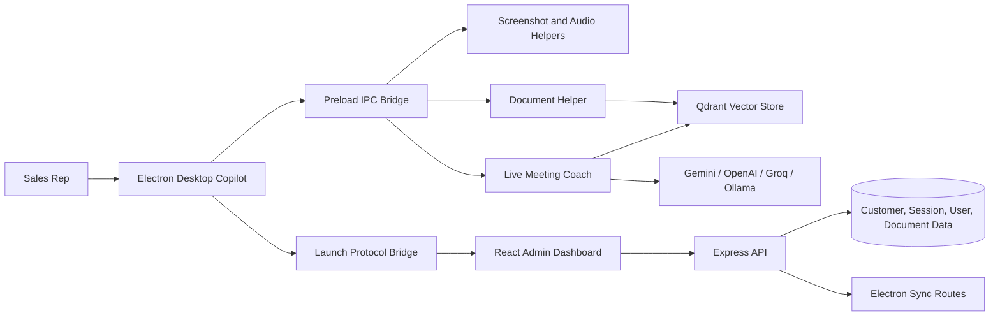

[Read the full architecture](docs/03-system-architecture.md)

## AI Workflow Preview

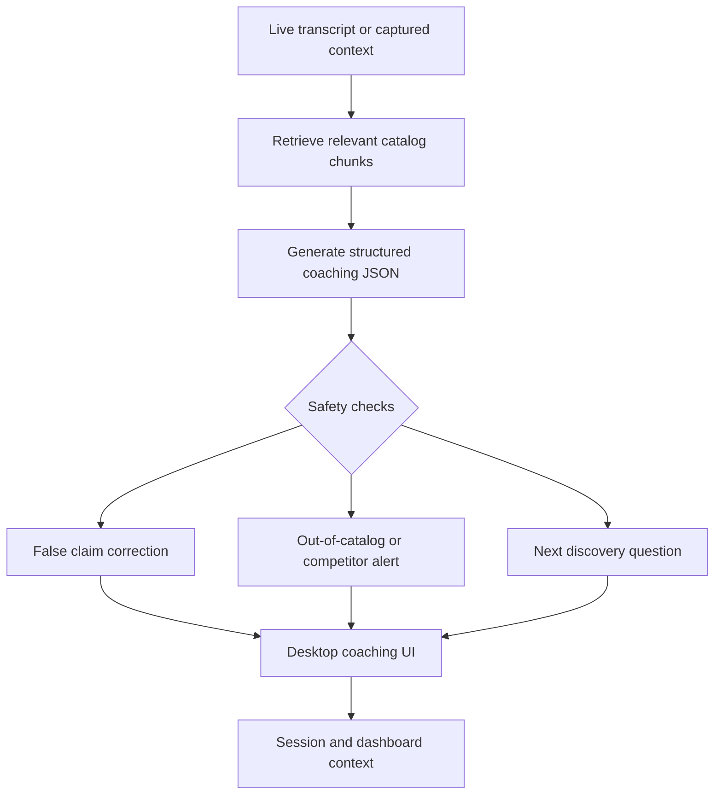

[Read the AI workflow](docs/04-ai-workflow.md)

## Screenshot Gallery

Screenshots are captured with demo data and selected to show the product from live desktop coaching through team-level dashboard operations.

| Desktop Copilot | Live Coaching |
| --- | --- |
| 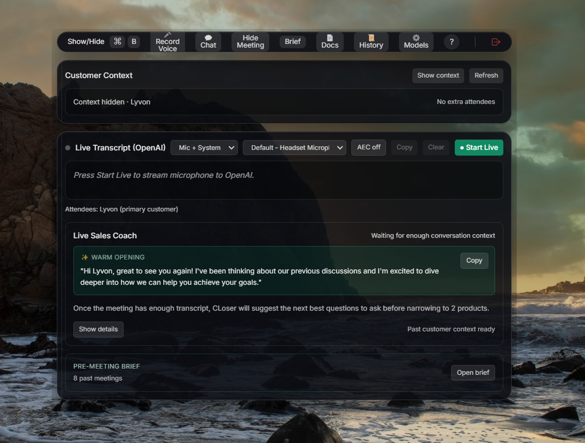 | 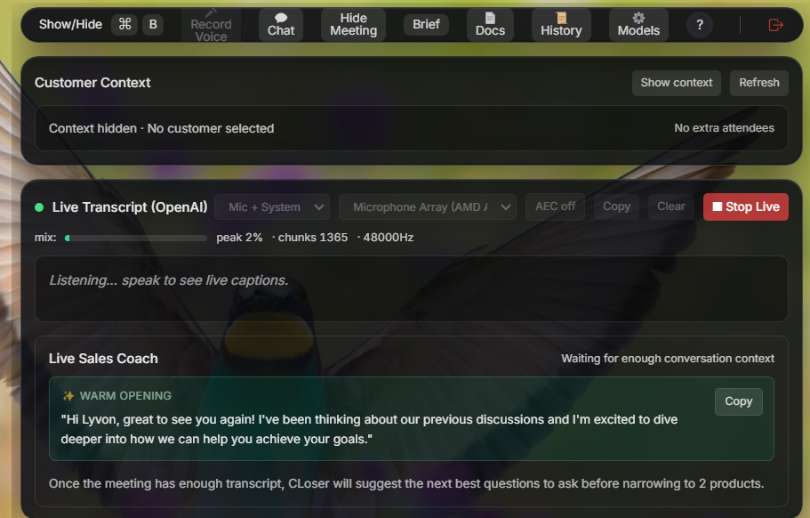 |
| The Electron assistant keeps transcript, customer context, and meeting controls available during the call. | The live coach turns conversation context into practical next-step guidance. |

| Team Dashboard | Customer Memory |
| --- | --- |
| 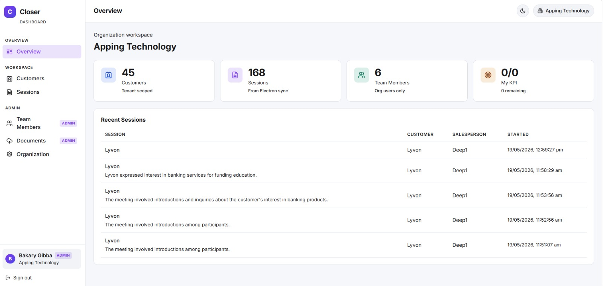 | 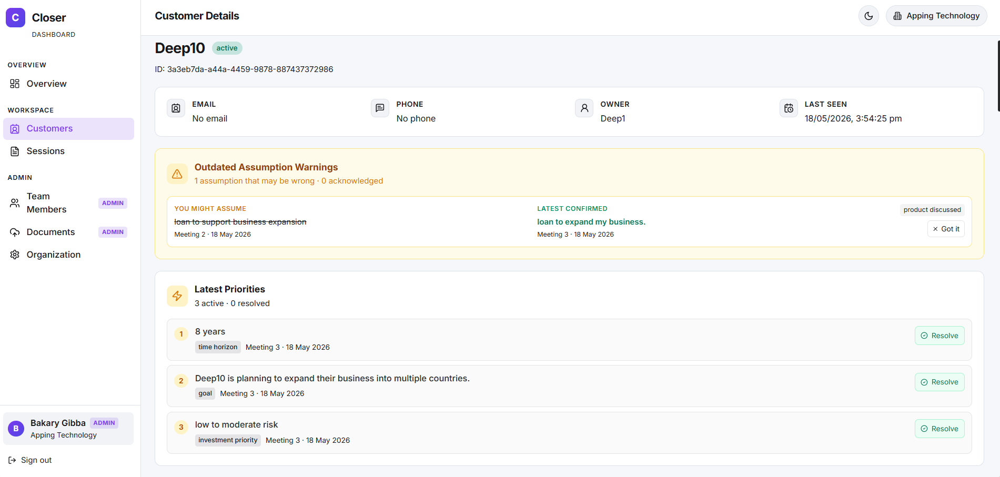 |
| Managers can review operating metrics, recent sessions, and team activity. | Customer profiles preserve priorities, warnings, and relationship context over time. |

<strong>More Screenshots</strong>

| Workflow | Screenshot |
| --- | --- |
| Safety alert | 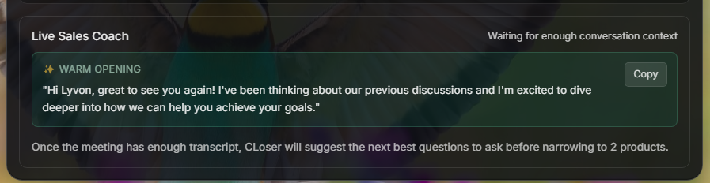 |
| Model selection | 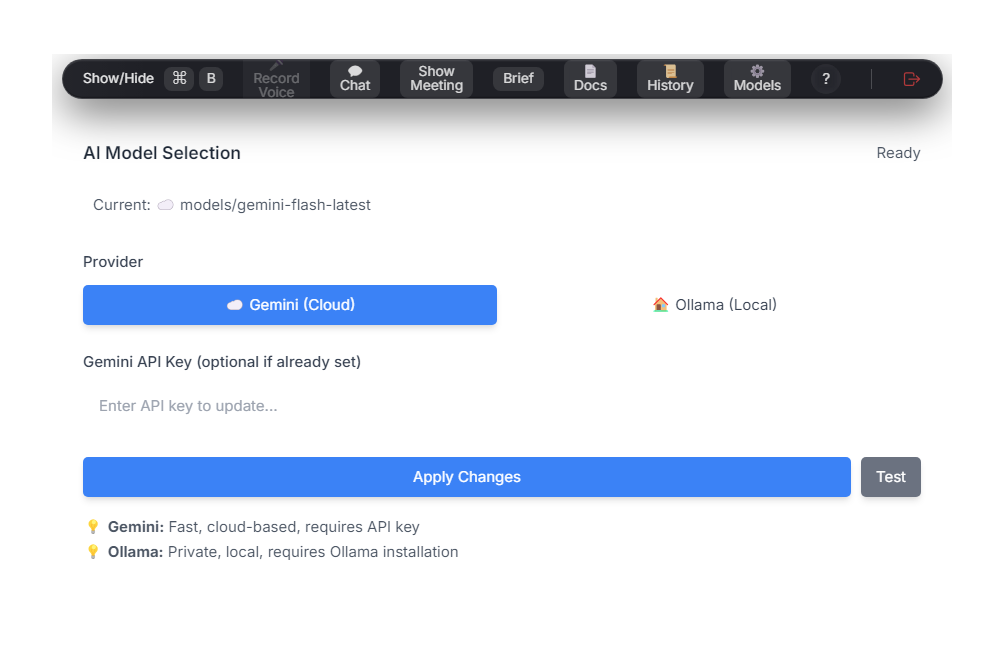 |
| Sessions | 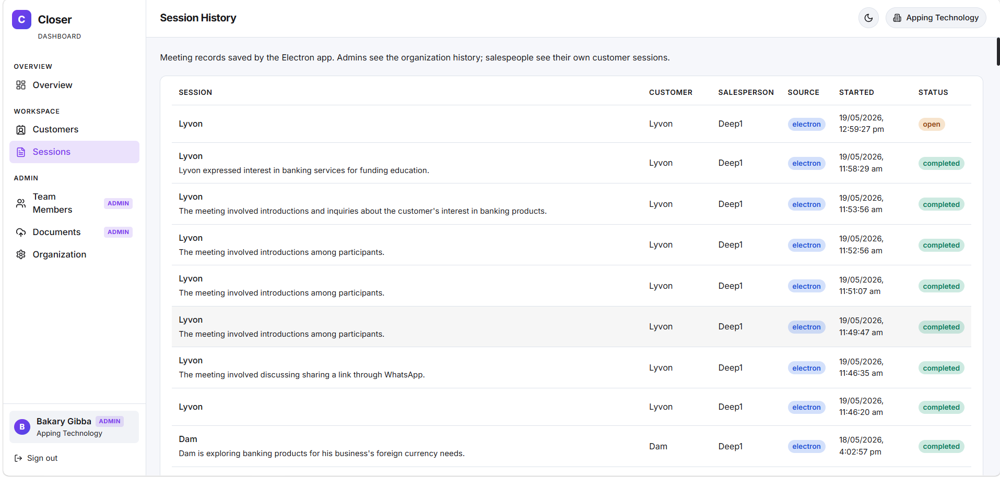 |
| Session details | 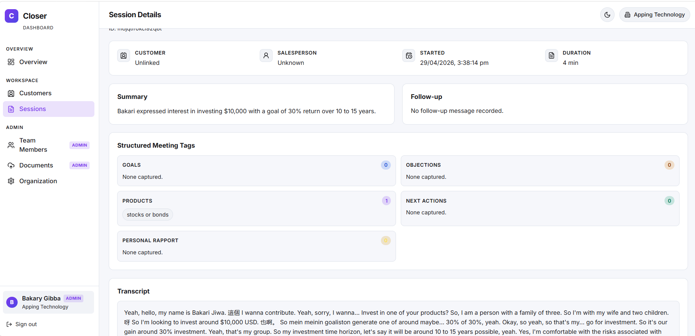 |
| Customers | 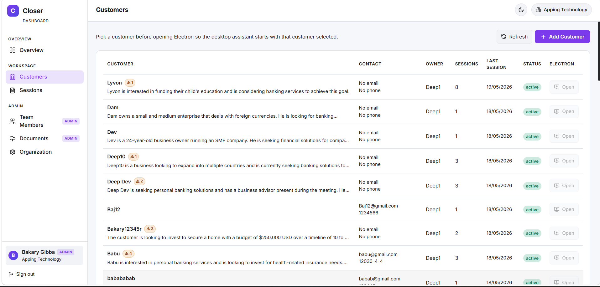 |
| Documents | 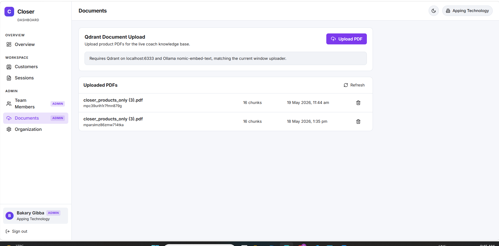 |
| Settings | 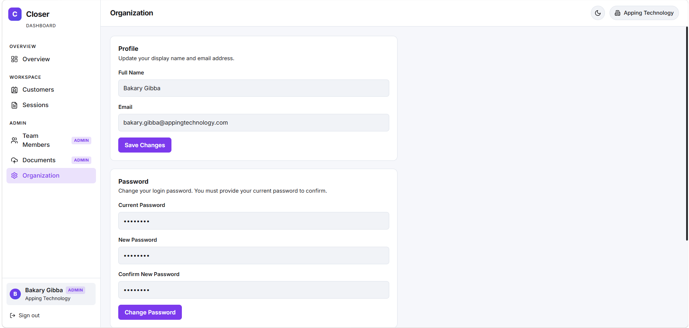 |

[View screenshot capture plan](screenshots/README.md)

## Documentation Navigation

| Document | What It Explains |
| --- | --- |
| [01 Executive Summary](docs/01-executive-summary.md) | Portfolio summary and system value |
| [02 Business Problem](docs/02-business-problem.md) | Why live sales coaching needs AI and guardrails |
| [03 System Architecture](docs/03-system-architecture.md) | Desktop, dashboard, API, RAG, and launch bridge |
| [04 AI Workflow](docs/04-ai-workflow.md) | Transcription, retrieval, safety checks, and coaching |
| [05 Desktop App](docs/05-desktop-app.md) | Electron overlay, shortcuts, capture, IPC |
| [06 Dashboard](docs/06-dashboard.md) | Admin/customer/session/document surfaces |
| [07 RAG And Documents](docs/07-rag-and-documents.md) | Document ingestion, chunking, Qdrant search |
| [08 Data Model](docs/08-data-model.md) | Tenants, users, customers, sessions, documents, memory |
| [09 API Overview](docs/09-api-overview.md) | Dashboard and Electron sync endpoint groups |
| [10 Engineering Decisions](docs/10-engineering-decisions.md) | Trade-offs and architecture choices |
| [11 Challenges](docs/11-challenges.md) | Hallucination, tenant mismatch, privacy, realtime UX |
| [12 My Contributions](docs/12-my-contributions.md) | Contribution narrative |
| [13 Future Improvements](docs/13-future-improvements.md) | Roadmap and production hardening |
| [Appendix](docs/appendix.md) | Glossary, safety notes, reviewer checklist |
| [Diagram Plan](diagrams/README.md) | Editable Mermaid diagrams |
| [Screenshot Plan](screenshots/README.md) | Capture list and privacy guidance |

## Key Achievements

- Built a desktop AI copilot with Electron, global shortcuts, screenshot capture, audio/transcription, and model switching.
- Added document-grounded RAG using Qdrant and local embeddings for catalog-aware recommendations.
- Designed live meeting coaching that returns structured readiness, next questions, correction alerts, and admin alerts.
- Created a dashboard for customer/session/document/user operations.
- Produced a multi-tenant architecture proposal to make prompts, scoring, and vector isolation configurable by industry.
- Added hallucination benchmarking and manual test runners to evaluate coaching quality.

## Lessons Learned

> [!IMPORTANT]
> A sales copilot must be useful in the moment, but safe under pressure. The best design choices make uncertainty visible: missing information, out-of-catalog claims, false product assumptions, and low retrieval confidence should change the assistant's behavior.

- Realtime coaching should prioritize the next best question over long explanations.
- RAG helps only when retrieval scope, chunk structure, and product names are explicit.
- Local AI options matter for privacy-sensitive meeting workflows.
- Multi-tenant AI products need configuration guardrails, not freeform prompt editing.
- Dashboards are essential for turning individual assistance into team learning.
