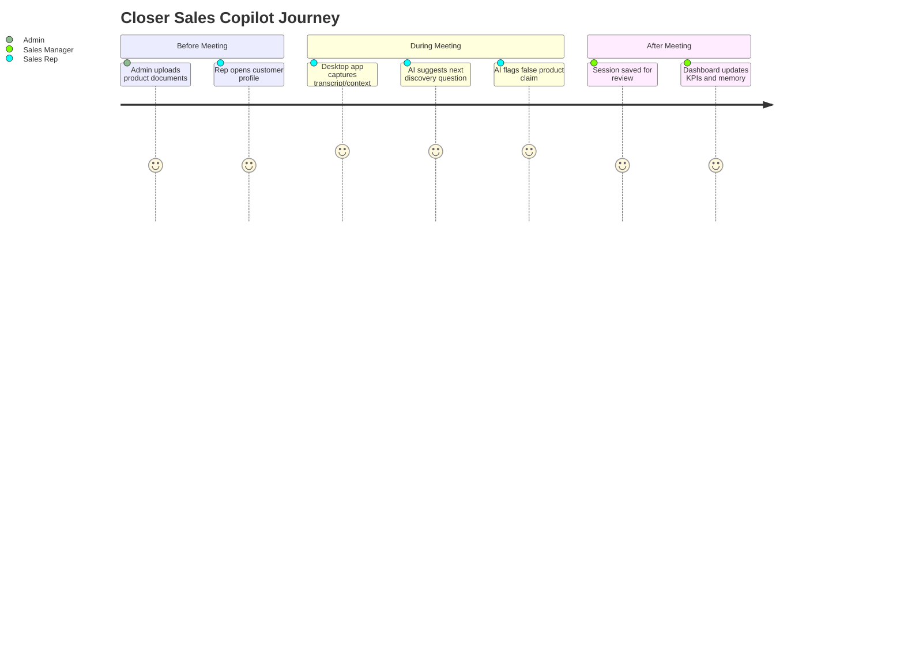

[Back to README](../README.md)

# 02 Business Problem

## Problem

Sales representatives often need to process product knowledge, customer context, compliance constraints, and live objections at the same time. Generic AI chat tools are too detached from the conversation, while static sales playbooks are too slow to search during a call.

Closer addresses that gap by creating a live copilot for discovery, coaching, and grounded recommendations.

## Stakeholders

| Stakeholder | Need |
| --- | --- |
| Sales rep | Ask better questions and avoid incorrect product claims |
| Sales manager | Review sessions, KPIs, and coaching quality |
| Customer success/admin | Manage documents, customers, and users |
| Organization | Keep recommendations grounded in approved knowledge |

## Why This Is Hard

- Meeting context changes in realtime.
- Product recommendations can be high-stakes.
- Reps need short, readable coaching, not long model output.
- Uploaded documents must constrain the assistant.
- Different industries need different scoring logic and prompts.

## User Journey

## Screenshot

The live coaching surface shows the core product promise: concise guidance during the meeting, not after it.
