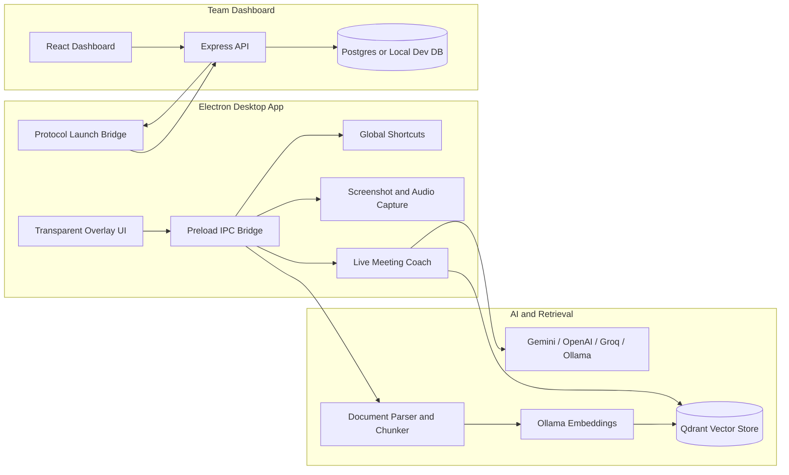

[Back to README](../README.md)

# 03 System Architecture

## Architecture Summary

Closer has two main surfaces: a desktop Electron copilot for live work and a dashboard for operational management. The desktop app communicates through an IPC bridge to helpers for screenshots, audio, documents, sessions, AI providers, vector retrieval, and authentication.

## Boundaries

| Boundary | Why It Exists |
| --- | --- |
| Electron IPC | Keeps renderer UI separate from privileged desktop capabilities |
| AI provider abstraction | Supports cloud and local model choices |
| Vector helper | Keeps retrieval, chunking, embeddings, and Qdrant isolated |
| Dashboard API | Gives teams operational views beyond the desktop assistant |
| Launch protocol | Connects dashboard context to the desktop app |

## Screenshot

The desktop queue shows the Electron copilot surface that connects live transcript, customer context, documents, history, and model controls.
