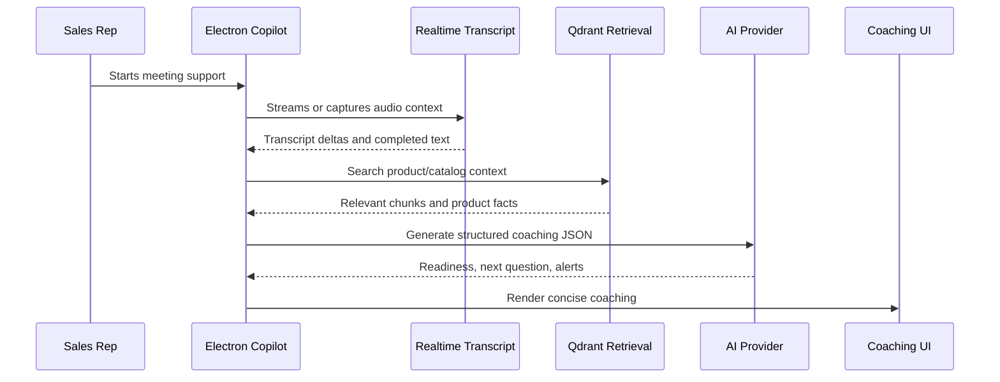

[Back to README](../README.md)

# 04 AI Workflow

## Workflow Summary

Closer's AI workflow is designed around live coaching rather than generic chat. It turns transcript and captured context into structured guidance: confidence, readiness, client summary, factual answer, missing information, next question, recommendation focus, correction alert, and admin alert.

## Live Coaching Flow

## Safety Checks

| Check | Purpose |
| --- | --- |
| False premise | Correct wrong product facts before coaching continues |
| External forecast | Avoid treating outside predictions as valid product rationale |
| Competitor/out-of-catalog | Flag references outside approved knowledge |
| Factual product question | Answer directly from catalog when possible |
| Discovery readiness | Ask the highest-priority missing question |

## Screenshot

The live coach converts meeting context into next-step guidance that a sales rep can use immediately.
