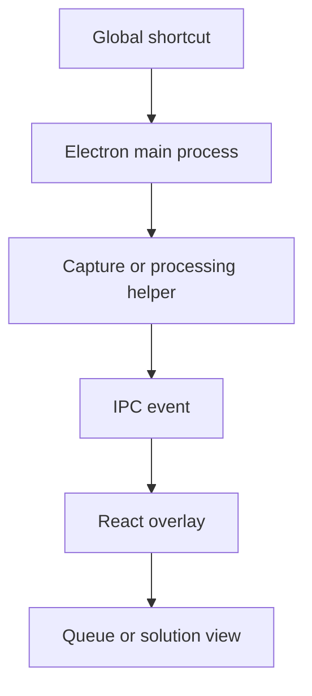

[Back to README](../README.md)

# 05 Desktop App

## Desktop Summary

The desktop app is built with Electron and React. It provides a lightweight overlay that can be toggled with shortcuts, take screenshots, process audio, run realtime transcription, and show concise AI output during active work.

## Core Desktop Capabilities

| Capability | Description |
| --- | --- |
| Transparent overlay | Keeps coaching visible without a full app switch |
| Global shortcuts | Toggle window, capture screenshots, move window, reset view |
| Screenshot queue | Captures and previews screen context for AI processing |
| Audio analysis | Transcribes or analyzes audio input |
| Model switching | Supports Gemini and Ollama/local model modes |
| Launch protocol | Lets dashboard context open the desktop app with authenticated session state |

## Desktop Event Flow

## Screenshot

The desktop assistant demonstrates the in-call control surface for transcript, customer context, documents, history, and models.
