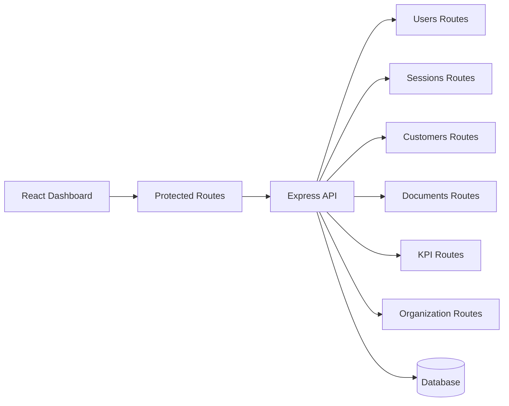

[Back to README](../README.md)

# 06 Dashboard

## Dashboard Summary

The dashboard is the operational layer for Closer. It turns individual meeting assistance into a team-managed system with customers, sessions, documents, users, organization settings, and KPI views.

## Dashboard Surfaces

| Surface | Purpose |
| --- | --- |
| Overview | KPIs, activity, and operating summary |
| Sessions | Meeting history and coaching traces |
| Session details | Transcript, context, and recommendations |
| Customers | Customer profiles and relationship memory |
| Documents | Knowledge-base upload and management |
| Users | Admin-controlled team access |
| Settings | Organization-level configuration |

## Dashboard Architecture

## Screenshot

The dashboard overview shows the operating layer for customers, sessions, users, and KPIs.
