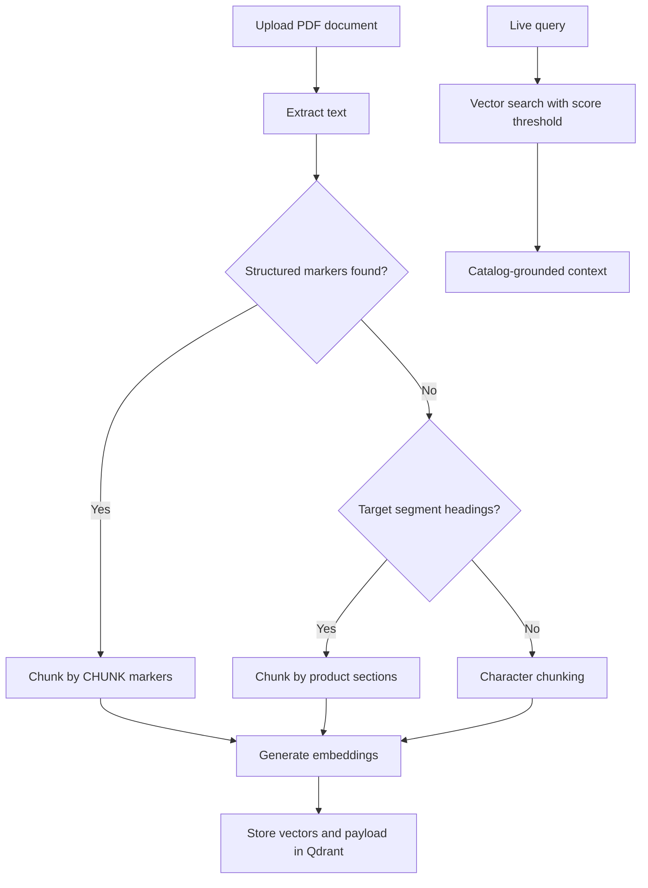

[Back to README](../README.md)

# 07 RAG And Documents

## RAG Summary

Closer indexes uploaded product or knowledge documents into Qdrant. The retrieval layer uses Ollama embeddings and structured chunking to make product names, compliance sections, fit maps, and methodology chunks searchable during live coaching.

## Document Flow

## Retrieval Design

| Design Choice | Reason |
| --- | --- |
| Structured chunk types | Keeps product, compliance, methodology, and fit-map knowledge distinguishable |
| Product name payloads | Makes recommendations traceable to exact catalog products |
| Score threshold | Reduces low-confidence retrieval from feeding the model |
| Local embeddings | Supports privacy-conscious document processing |

## Screenshot

The documents view shows how administrators upload product PDFs into the Qdrant-backed knowledge base.
