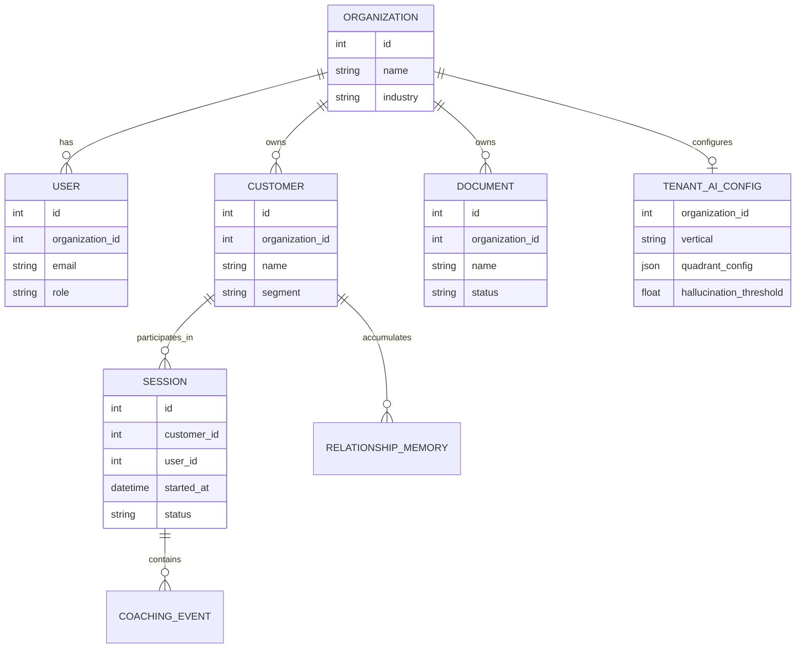

[Back to README](../README.md)

# 08 Data Model

## Data Model Summary

Closer's dashboard data model centers on organizations, users, customers, sessions, documents, and relationship memory. The multi-tenant roadmap extends this with tenant-specific AI configuration, prompts, quadrant logic, vector namespaces, and hallucination thresholds.

## Conceptual ERD

## Multi-Tenant Direction

The project identifies a key future requirement: remove hardcoded financial-services assumptions and make the assistant configurable by tenant and industry.

## Screenshot

The customer profile illustrates how sessions become durable relationship memory, priorities, and warning signals.
