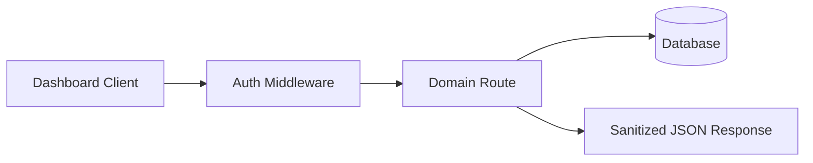

[Back to README](../README.md)

# 09 API Overview

## API Summary

The dashboard API is an Express service organized around authentication, users, customers, sessions, documents, organization settings, KPIs, and Electron sync.

> [!CAUTION]
> This page documents behavior-level API groups only. It does not expose tokens, database files, private customer records, or source code.

## Endpoint Groups

| Group | Responsibility |
| --- | --- |
| Auth | Login and protected session state |
| Users | Team/user administration |
| Customers | Customer list and profile context |
| Sessions | Meeting session history and details |
| Documents | Knowledge-base document management |
| Organization | Organization configuration |
| KPIs | Dashboard metrics |
| Electron sync | Launch and context exchange with desktop app |

## Request Flow

## Screenshot

The session detail view shows how desktop meeting intelligence is synchronized into the dashboard for review.
