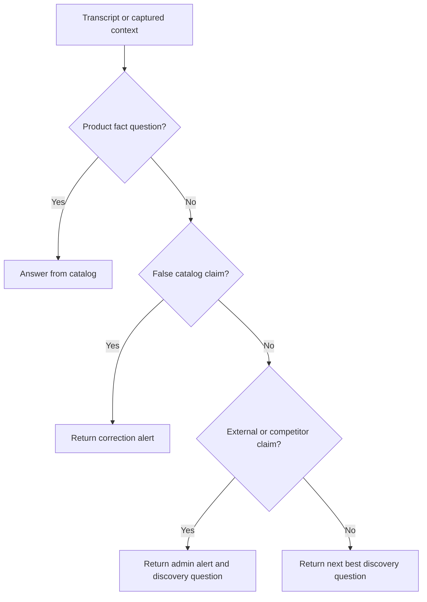

[Back to README](../README.md)

# 10 Engineering Decisions

## Decision Summary

Closer balances live usefulness, privacy, and correctness. The project makes several important trade-offs: desktop overlay versus full web app, local models versus cloud models, structured coaching versus freeform chat, and tenant templates versus raw prompt editing.

## Key Trade-offs

| Decision | Trade-off | Outcome |
| --- | --- | --- |
| Electron overlay | More desktop complexity, better in-meeting ergonomics | Assistance is available without switching apps |
| Local Ollama option | More setup, stronger privacy | Users can process sensitive context locally |
| RAG over model memory | More infrastructure, better grounding | Product claims can reference approved documents |
| Structured JSON coaching | Less expressive, more reliable UI | Readiness, questions, and alerts are machine-readable |
| Dashboard plus desktop | More architecture, better team operations | Managers can review sessions and manage data |
| Template-based multi-tenancy | Less admin freedom, safer configuration | Prevents prompt/configuration mistakes at scale |

## Decision Flow

## Screenshot

The settings surface supports the architecture story around organizational configuration and operational control.
