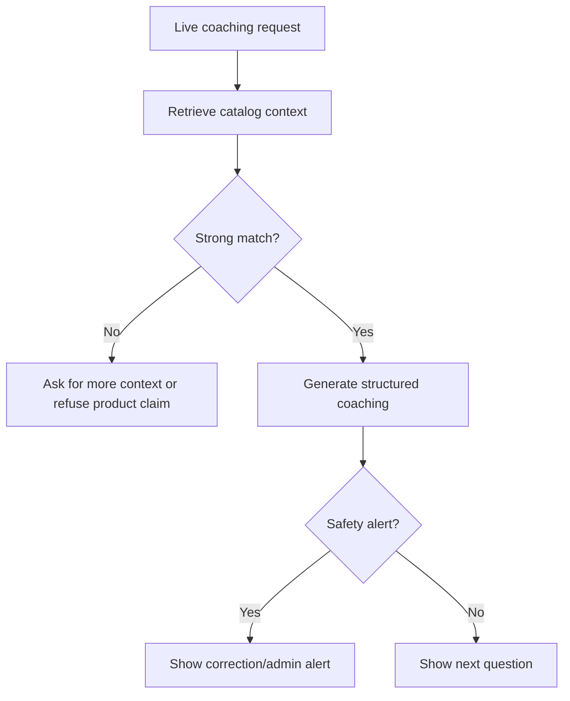

[Back to README](../README.md)

# 11 Challenges

## Challenge Summary

The main engineering challenges are realtime context handling, hallucination control, privacy, desktop permissions, and preventing domain-specific assumptions from leaking into a multi-tenant product.

## Challenge Matrix

| Challenge | Risk | Mitigation |
| --- | --- | --- |
| Hallucinated product advice | Incorrect or non-compliant sales guidance | RAG, source grounding, score thresholds, correction alerts |
| Hardcoded domain assumptions | Non-financial tenants receive bad coaching | Configurable prompts, quadrant logic, chunk markers |
| Desktop capture permissions | Screenshots/audio may fail or require OS permissions | Electron helpers and clear runtime setup |
| Realtime overload | Model output becomes too long during calls | Structured coaching with one next question |
| Tenant data bleed | Documents from one tenant influence another | Proposed isolated vector collections |
| Cloud privacy concerns | Sensitive meeting context leaves device | Ollama/local mode and provider switching |

## Risk Flow

## Screenshot

The alert state shows how Closer makes uncertainty and safety issues visible during live coaching.
