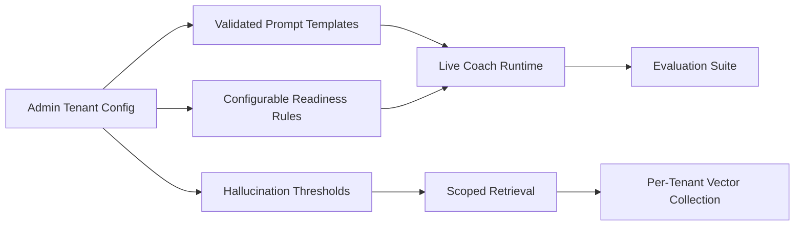

[Back to README](../README.md)

# 13 Future Improvements

## Roadmap Summary

Future work should focus on production-grade multi-tenancy, tenant configuration UX, evaluation automation, observability, and deeper privacy controls.

## Recommended Improvements

| Area | Improvement | Benefit |
| --- | --- | --- |
| Tenant configuration | Admin UI for vertical templates, quadrant logic, and thresholds | Enables self-service onboarding |
| Vector isolation | Per-tenant Qdrant collections or namespaces | Prevents cross-tenant document bleed |
| Citation UX | Show source document and section for every claim | Improves trust and compliance |
| Evaluation suite | Automate hallucination benchmark runs in CI | Makes prompt/model changes safer |
| Local-first mode | Expand Ollama and local transcription support | Strengthens privacy posture |
| Observability | Trace retrieval, model calls, and coaching outcomes | Speeds debugging and quality review |
| Role governance | Fine-grained admin permissions | Reduces misconfiguration risk |

## Future Architecture

## Screenshot

The model selector represents the current provider-control foundation that can evolve into tenant-specific AI configuration.
